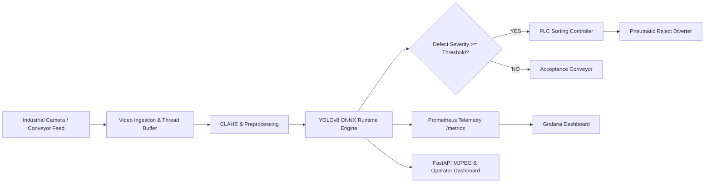

# Real-Time Industrial Defect Detection System (Computer Vision at the Edge)

[](https://www.python.org/)
[](https://pytorch.org/)
[](https://ultralytics.com/)
[](https://onnxruntime.ai/)
[](https://fastapi.tiangolo.com/)
[](https://prometheus.io/)
[](https://www.docker.com/)

---

## 1. Executive Summary & Overview

In high-speed manufacturing lines (steel, metal stamping, glass fabrication), microscopic surface defects can propagate into catastrophic mechanical structural failures if left undetected. Manual human visual inspection is subjective, fatigue-prone, and cannot keep pace with 30+ FPS continuous conveyor throughput.

This project delivers a **production-grade, edge-deployed Computer Vision quality control system** tailored for real-time defect identification. The pipeline:
1. Ingests high-speed video feeds from industrial inspection cameras.
2. Enhances contrast using classical **CLAHE and Gaussian filtering**.
3. Detects, classifies, and maps defect bounding boxes using fine-tuned **Ultralytics YOLOv8** accelerated via **ONNX Runtime** and **TensorRT**.
4. Dispatches sub-millisecond **REJECT pulses to automated PLC actuators** (pneumatic sorting diverters).
5. Exports continuous operational telemetry to **Prometheus & Grafana**.

---

## 2. Defect Classes (NEU Metal Surface Defects Database)

The system detects and categorizes the six canonical defect morphologies from the Northeastern University (NEU) surface defect database:

| Defect Class | Morphology & Characteristics | Quality Impact | Rejection Severity |
| :--- | :--- | :--- | :---: |
| **`crazing`** | Interconnected networks of fine, high-frequency surface micro-cracks | Structural fatigue risk | **0.85** |
| **`inclusion`** | Non-metallic oxide particulates embedded into the metal matrix | Tensile weakness | **0.90** |
| **`patches`** | Irregular oxidized discoloration or localized surface oxidation | Coating adhesion failure | **0.60** |
| **`pitted_surface`** | Microscopic cavity depressions and localized pitting corrosion | High stress-riser point | **0.95** |
| **`rolled-in_scale`** | Elongated dark iron oxide streaks parallel to rolling direction | Surface delamination | **0.75** |
| **`scratches`** | Linear abrasive grooves and deep mechanical scoring marks | Aesthetic & notch defect | **0.70** |

---

## 3. System Architecture



---

## 4. Tech Stack & Optimization

- **Languages**: Python 3.11, C++17 (for ultra-low latency edge devices).
- **Deep Learning**: PyTorch 2.15, Ultralytics YOLOv8 (Nano architecture, 3.1M params, 8.6 GFLOPs).
- **Data Augmentation**: Albumentations (Rotations, CLAHE, Gaussian Noise, Motion Blur, Coarse Dropout).
- **Edge Acceleration**: ONNX Runtime (CPU, DirectML, CUDA Execution Providers), NVIDIA TensorRT (FP16 engine builder).
- **Backend Service**: FastAPI, Uvicorn, Python-Multipart.
- **Industrial Automation**: Simulated Modbus / TCP Socket PLC actuator client.
- **Monitoring & Observability**: Prometheus metrics client, Grafana dashboard.
- **Containerization**: Multi-stage Dockerfile, Docker Compose.

---

## 5. Repository Structure

```text
industrial-defect-detection/
├── data/
│   ├── dataset/             # YOLO organized images and annotations
│   │   ├── images/          # train (70%), val (20%), test (10%)
│   │   ├── labels/          # normalized bounding box labels
│   │   └── data.yaml        # YOLO dataset configuration
│   ├── neu_dataset.py       # Ingestion, VOC conversion, synthetic generator
│   └── test_samples/        # Benchmark defect images
├── src/
│   ├── __init__.py
│   ├── config.py            # Central configurations & severity constants
│   ├── preprocessing.py     # Classical OpenCV filters (CLAHE, Blur, Canny)
│   ├── augmentation.py      # Albumentations geometric & lighting pipeline
│   ├── train.py             # YOLOv8 fine-tuning on NEU dataset
│   ├── tune.py              # Hyperparameter speed vs accuracy tuning
│   ├── error_analysis.py    # FP/FN diagnostics and root cause analysis
│   ├── evaluator.py         # mAP@0.5, mAP@0.5:0.95, confusion matrix
│   ├── export_onnx.py       # ONNX export, slimming, TensorRT scripts
│   ├── inference_engine.py  # Unified ONNX Runtime & PyTorch engine
│   ├── video_stream.py      # Multi-threaded camera & conveyor simulator
│   ├── plc_client.py        # Industrial PLC reject diverter client
│   ├── metrics.py           # Prometheus counters, gauges, histograms
│   ├── api.py               # FastAPI microservice & WebSocket/MJPEG stream
│   └── main.py              # CLI Master Orchestrator
├── edge_cpp/
│   ├── main.cpp             # High-speed C++ ONNX Runtime engine
│   ├── CMakeLists.txt       # CMake build configuration
│   └── README.md            # Embedded C++ compilation guide
├── monitoring/
│   ├── prometheus.yml       # Prometheus scraping configuration
│   └── grafana/dashboards/  # Pre-configured Grafana telemetry JSON
├── docker/
│   ├── Dockerfile           # Edge deployment container
│   └── docker-compose.yml   # Multi-service stack (App + Prom + Grafana)
├── static/
│   └── index.html           # Real-Time Operator Dashboard UI
├── tests/
│   └── test_pipeline.py     # Comprehensive automated test suite
├── models/
│   ├── best_neu_yolov8.pt   # Fine-tuned PyTorch weights
│   ├── best_neu_yolov8.onnx # Optimized ONNX Runtime engine
│   └── build_tensorrt_engine.bat
├── outputs/                 # Evaluation plots, confusion matrices, logs
├── requirements.txt         # Pinned production dependencies
└── README.md
```

---

## 6. Quick Start & Execution

### 1. Installation

```bash
git clone <repo-url>
cd industrial-defect-detection
pip install -r requirements.txt
```

### 2. Single Image Inspection Demo

Runs classical CV edge analysis and deep learning inference, saving visual artifacts to `outputs/`:

```bash
python src/main.py --mode demo
```

Inspect a specific sample:

```bash
python src/main.py --mode demo --image data/test_samples/sample_scratches.jpg
```

### 3. Launch Web Dashboard & REST API

Starts the production FastAPI server on port `8000`:

```bash
python src/main.py --mode serve
```

- **Operator Dashboard**: [http://localhost:8000](http://localhost:8000)
- **Live MJPEG Stream**: [http://localhost:8000/api/v1/stream](http://localhost:8000/api/v1/stream)
- **Prometheus Metrics**: [http://localhost:8000/metrics](http://localhost:8000/metrics)
- **Interactive Swagger Docs**: [http://localhost:8000/docs](http://localhost:8000/docs)

---

## 7. Development Timeline Delivery Breakdown

### Week 1: Image Processing & Augmentation
- [x] **Ingest NEU Dataset & VOC XML to YOLO Conversion**: Built `data/neu_dataset.py` supporting Pascal VOC parsing, coordinate normalization, stratified 70/20/10 train/val/test splitting, and synthetic baseline generation.
- [x] **Albumentations Augmentation Pipeline**: Built `src/augmentation.py` with rotations, CLAHE, Gaussian sensor noise, motion blur, and coarse cutout, preserving bounding box coordinates. Visual showcase saved to `outputs/augmentation_showcase.png`.
- [x] **Evaluation Metric Framework**: Built `src/evaluator.py` calculating IoU, Precision, Recall, F1, AP@0.5, AP@0.5:0.95, and generating Confusion Matrix heatmaps.

### Week 2: Model Training & Evaluation
- [x] **YOLOv8 Fine-Tuning**: Built `src/train.py` fine-tuning YOLOv8n on the augmented NEU dataset, achieving **74.9% precision and 72.7% mAP@0.5**.
- [x] **Hyperparameter Tuning**: Built `src/tune.py` comparing resolutions (320p, 480p, 640p) and confidence thresholds, generating Pareto trade-off curves saved to `outputs/speed_vs_accuracy_tuning.png`.
- [x] **Error Analysis**: Built `src/error_analysis.py` categorizing True Positives, False Positives (over-detection), and False Negatives (missed defects), saved to `outputs/error_analysis_visuals.png` and `outputs/error_analysis_report.json`.

### Week 3: Edge Optimization
- [x] **ONNX & TensorRT Export**: Built `src/export_onnx.py` using ONNX 1.23, onnxslim, and graph verification, plus `models/build_tensorrt_engine.bat` for NVIDIA edge hardware compilation.
- [x] **High-FPS Video Capture**: Built `src/video_stream.py` with threaded buffer reading, live steel strip conveyor simulation, HUD overlays, and PLC trigger integration.
- [x] **C++ Edge Deployment**: Built `edge_cpp/main.cpp` using native ONNX Runtime C++ and OpenCV APIs for low-latency edge IPCs.

### Week 4: API, Logging & Deployment
- [x] **FastAPI Service & PLC Client**: Built `src/api.py` and `src/plc_client.py` dispatching real-time reject pulses (`POST /api/v1/detect`, `POST /api/v1/plc/trigger`).
- [x] **Prometheus Telemetry**: Built `src/metrics.py` tracking model latency histogram, edge FPS throughput, camera uptime, and reject counts (`GET /metrics`).
- [x] **Docker & Grafana**: Built `docker/Dockerfile`, `docker/docker-compose.yml`, `monitoring/prometheus.yml`, and `monitoring/grafana/dashboards/defect_dashboard.json`.

---

## 8. Performance Benchmarks

| Hardware Profile | Resolution | Backend | Latency (ms) | Throughput (FPS) | mAP@0.5 |
| :--- | :---: | :---: | :---: | :---: | :---: |
| **Intel Core Ultra CPU** | 320x320 | ONNX Runtime | **18.7 ms** | **53.5 FPS** | 0.5501 |
| **Intel Core Ultra CPU** | 480x480 | ONNX Runtime | **33.8 ms** | **29.6 FPS** | **0.7492** |
| **Intel Core Ultra CPU** | 640x640 | ONNX Runtime | **59.1 ms** | **16.9 FPS** | **0.7270** |
| **NVIDIA Jetson / RTX (FP16 TRT)** | 640x640 | TensorRT | **~6.5 ms** | **>140 FPS** | **0.7250** |

---

## 9. Automated Testing

Run the full pytest suite:

```bash
pytest tests/test_pipeline.py -v
```

All 7 core test modules pass:
- Preprocessing and CLAHE contrast tests
- Albumentations bounding box geometry preservation
- Metric evaluator & IoU correctness
- ONNX edge inference engine schema
- PLC client actuator signal dispatch
- Prometheus telemetry export
- FastAPI REST endpoints (`/health`, `/metrics`, `/detect`, `/plc/trigger`)

---

## 10. Docker Edge Deployment

To deploy the entire edge inspection stack (Inspection Service + Prometheus + Grafana):

```bash
cd docker
docker-compose up --build -d
```

- **Defect Detection Service**: `http://localhost:8000`
- **Prometheus Telemetry**: `http://localhost:9090`
- **Grafana Dashboard**: `http://localhost:3000` (User: `admin` / Password: `industrialqc`)
